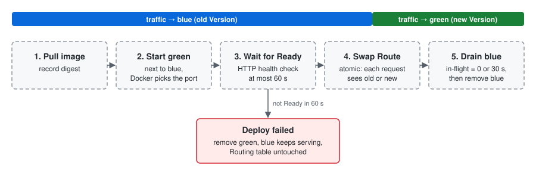

# Architecture

This document describes the **target** architecture of Mini PaaS. Each part is marked:

- ✅ **implemented** — exists in the code today
- 🚧 **planned** — designed but not written yet

Terms in **bold** (App, Version, Replica, Route, …) have exact meanings defined in [docs/CONTEXT.md](docs/CONTEXT.md).

## Bird's-eye view


Mini PaaS runs on **one machine** as **one process** that contains two parts sharing memory:

| Part | Job | Status |
|---|---|---|
| **Router** | Accepts HTTP requests on `:3000`, finds the **Route** for the request's `Host`, forwards it to a **Ready** **Replica** | ✅ |
| **Control plane** | HTTP API (`axum`): receives deploy commands, drives Docker, stores state in SQLite, replaces the **Routing table**, streams progress over SSE, serves the admin UI | 🚧 |

They share the **Routing table** in memory instead of talking over a protocol. Why: [ADR 0001](docs/adr/0001-router-and-control-plane-in-one-process.md).

External pieces:

| Piece | Used for | Status |
|---|---|---|
| Docker Engine (via `bollard`) | Pull images, run/remove containers; Docker picks the host port | 🚧 |
| SQLite | Apps, Versions (by digest), deploy history | 🚧 |
| Admin UI (Vite + React + TS) | Static files served by the control plane | 🚧 |
| Cloudflare Tunnel | Public URL for the demo (not used for measurements) | 🚧 |

## Request path ✅

What happens to one request, in order (`router/src/main.rs`, `handle_request`):

1. **Accept** — a `tokio` task per TCP connection, served by `hyper` HTTP/1.1.
2. **Middleware (request side)** — each middleware may modify the request or answer early. Today: logging, add `X-Gateway` header.
3. **Find Route** — `Host` header, port stripped, lower-cased (`Users.Localhost:3000` → `users.localhost`). No Route → `404`.
4. **Pick Replica** — round-robin over Replicas currently marked Ready. None Ready → `503`.
5. **Forward** — rewrite the URI to the Replica's address (path and query unchanged), drop hop-by-hop headers (`Connection`, `Upgrade`, …), set `X-Forwarded-For`, keep all other client headers (`Cookie`, `Authorization`, …). Uses a pooled keep-alive client. Replica unreachable → `502`.
6. **Middleware (response side)** — in reverse order. Today: logging with latency, add `X-Powered-By` header.

## Routing table ✅ (partly)

```
Router
└── RwLock<HashMap<host, Arc<Route>>>
    └── Route { host, health_path, RwLock<Vec<Backend>>, round-robin counter }
```

- A request clones the `Arc<Route>` under a short read lock, then works on that snapshot. Replacing a host's Route therefore never shows a request a half-updated Route: it sees the old one or the new one.
- Today `Router::set_route` replaces **one host at a time**. 🚧 The design in CONTEXT.md says the whole table is replaced at once; this becomes needed if one deploy ever touches more than one host.
- 🚧 Routes are hard-coded in `main.rs` until the control plane exists. On start-up the control plane will rebuild the table from SQLite plus the containers still running.

## Health checks ✅

A background task (`router/src/health.rs`) runs every 10 s. For each Replica it sends `GET <health_path>` (default `/`) and marks it Ready only on a `2xx` within 3 s. A plain TCP connect is not enough. Replicas that are not Ready are skipped in step 4 above.

## Deploy and version switch 🚧



A deploy of an App that is already running (blue) to a new Version (green):

1. **Pull** the image again and record its **digest** — the digest, not the tag, identifies the Version.
2. **Start green** next to blue. Docker assigns a free host port, so the two never clash. Container port and health path default to the image's `EXPOSE` and `/`.
3. **Wait for Ready**, at most 60 s.
   - Fails → blue keeps serving, green is removed, the deploy is recorded as failed, the Routing table is **not** touched.
4. **Swap the Route** atomically to green.
5. **Drain blue** — blue gets no new requests; the router counts **In-flight requests** per Replica. Blue is removed when its count reaches 0 or after 30 s; requests cut by the timeout count as **Failed requests**.

Rules: only one deploy per App at a time; progress of every step is pushed to the UI over SSE.

## Control plane API and auth 🚧

- One admin account, password hashed with `argon2`, browser session in an `HttpOnly` cookie.
- A separate API key for CI and CLI. The key is never shipped in browser code.

## Code map

Only files that exist today. Paths are relative to `router/`.

| File | What it does |
|---|---|
| `src/main.rs` | Start-up (hard-coded routes, health checks, middleware), accept loop, `handle_request`; end-to-end test that routes by Host and swaps a Route at runtime |
| `src/router.rs` | `Router` (routing table), `Route` (Replicas + round-robin), `Backend` (one Replica) |
| `src/proxy.rs` | Pooled HTTP client and `forward_request` (URI rewrite, hop-by-hop headers, `X-Forwarded-For`, `502`) |
| `src/health.rs` | Periodic HTTP health checks |
| `src/middleware/mod.rs` | `Middleware` trait and `MiddlewarePipeline` |
| `src/middleware/logging.rs` | Per-request log lines with latency |
| `src/middleware/headers.rs` | Add fixed request/response headers |
| `examples/backend.rs` | Test app: answers with its name after 100–200 ms, so requests are always in flight during a switch |
| `Dockerfile` | Packs `examples/backend.rs` as `testapp:<VERSION>` |
| `../bench/` | vegeta load test and per-second report, see [docs/benchmarking.md](docs/benchmarking.md) |

Naming note: the code says `Backend` where the docs say **Replica**, and `Gateway` for the **Router** state. The docs' words are the ones to keep.

## Invariants

These must stay true; break one only with a new ADR.

- A request sees either the old Route or the new one, never a mix.
- The Routing table changes only after the new Version is **Ready**.
- A failed deploy never affects the Version currently serving.
- The router never strips a path prefix or rewrites the path.
- The router never forwards hop-by-hop headers.

## Limitations

- Single node; if the process crashes, both router and control plane go down ([ADR 0001](docs/adr/0001-router-and-control-plane-in-one-process.md)).
- HTTP/1.1 only, no WebSocket or other protocol upgrades.
- Requests longer than the 30 s drain window are cut during a version switch.
- Out of scope: building images from source, private registries, automatic rollback after a switch, multi-tenant network isolation, path-prefix routing, multiple users.
