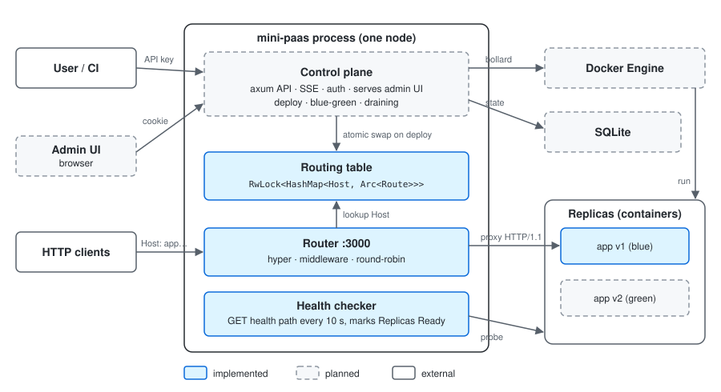

# ĐỀ XUẤT VÀ KẾ HOẠCH THỰC HIỆN PROJECT III (IT3940)

| | |
|---|---|
| **Sinh viên** | Seng Athit Bannavong |
| **MSSV** | 20239717 |
| **Lớp** | IT1-04 — Khoa học Máy tính K68 |
| **Giảng viên hướng dẫn** | TS. Nguyễn Đức Anh |
| **Học kỳ** | 2026.1 |

## 1. Tên đề tài

**Xây dựng nền tảng PaaS thu nhỏ với bộ định tuyến ingress tự phát triển và cơ chế triển khai không gián đoạn** (Mini PaaS)

## 2. Mô tả ý tưởng ngắn gọn

Nền tảng PaaS (Platform as a Service) cho phép lập trình viên đưa ứng dụng lên Internet mà không cần tự cấu hình máy chủ. Đề tài xây dựng một PaaS thu nhỏ chạy trên một máy chủ, trong đó thành phần cốt lõi là bộ định tuyến ingress tự phát triển.

Người dùng thao tác qua một giao diện quản trị web hoặc qua API của control plane (từ dòng lệnh, CI): tạo ứng dụng, triển khai phiên bản mới và theo dõi tiến trình chuyển phiên bản theo thời gian thực.

## 3. Mục tiêu

Mục tiêu không phải cạnh tranh với sản phẩm thương mại, mà là hiểu cơ chế nền tảng của hạ tầng cloud và đánh giá định lượng hành vi của hệ thống trong lúc chuyển phiên bản, so với Nginx và Traefik.

**Mục tiêu chính**

| Mã | Mục tiêu |
|:---|:----------------------------------------------------------------|
| M1 | Bộ định tuyến HTTP theo header `Host`, cập nhật bảng định tuyến động không cần khởi động lại tiến trình |
| M2 | Control plane triển khai ứng dụng từ Docker image và tự động đăng ký route |
| M3 | Health check chủ động và phân tải giữa nhiều replica |
| M4 | Triển khai không gián đoạn theo mô hình blue-green kết hợp connection draining |
| M5 | Đánh giá định lượng quá trình chuyển phiên bản dưới tải: số request lỗi, độ trễ p99 và thời gian từ lúc ra lệnh triển khai đến khi route có hiệu lực; so sánh với `nginx -s reload` và Traefik (Docker provider) |
| M6 | Giao diện quản trị web cho phép tạo, triển khai và theo dõi ứng dụng, hiển thị tiến trình chuyển phiên bản theo thời gian thực (SSE) |
| M7 | Cơ chế xác thực tối thiểu bảo vệ control plane: phiên đăng nhập cho trình duyệt và khóa API cho tiến trình tự động |

**Mục tiêu mở rộng (nếu còn thời gian)**

| Mã | Mục tiêu |
|:---|:----------------------------------------------------------------|
| E1 | TLS qua ACME sử dụng thư viện có sẵn |
| E2 | Triển khai giao diện quản trị như một ứng dụng trên chính hệ thống |

## 4.Hệ thống tổng quát

*Ghi chú: việc chạy giao diện quản trị như một ứng dụng trên Docker host trong sơ đồ thuộc mục tiêu mở rộng (E2); ở phạm vi chính, giao diện do control plane phục vụ.*

## 5. Phạm vi

**Trong phạm vi**

- Một node.
- Giao thức HTTP/1.1.
- Giao diện quản trị web, do control plane phục vụ dưới dạng tệp tĩnh.
- Xác thực tối thiểu cho một tài khoản quản trị.
- Đo đạc thực hiện trên máy cục bộ, không đi qua Cloudflare Tunnel.

**Đầu vào triển khai**

- Docker image đã build sẵn, lấy từ registry (Docker Hub / GHCR).
- Việc build image từ Dockerfile do CI bên ngoài (GitHub Actions) đảm nhiệm, không thuộc phạm vi hệ thống.
- Mỗi lần triển khai người dùng cung cấp: tên image, tên miền (`Host`), cổng trong container và đường dẫn health check.
- Cổng trong container và đường dẫn health check là tùy chọn: nếu bỏ trống, hệ thống lấy cổng từ khai báo `EXPOSE` của image và dùng đường dẫn `/`.
- Cổng phía máy chủ do Docker cấp phát tự động cho từng container, nên không xung đột cổng giữa các ứng dụng hay giữa hai phiên bản của cùng một ứng dụng.
- Image được pull lại ở mỗi lần triển khai và phiên bản được ghi nhận theo digest.
- Health check bằng request HTTP, không chỉ kiểm tra kết nối TCP.
- Bảng định tuyến chỉ thay đổi khi phiên bản mới đã sẵn sàng. Nếu phiên bản mới không qua health check trong 60 giây, phiên bản cũ tiếp tục phục vụ, container mới bị xóa và lần triển khai được ghi nhận là thất bại.
- Connection draining: bộ định tuyến đếm số request đang xử lý trên từng replica; sau khi chuyển route, phiên bản cũ không nhận request mới và chỉ bị xóa khi bộ đếm về 0 hoặc sau tối đa 30 giây. Request bị cắt do hết thời gian chờ được tính là request lỗi.

**Xác thực**

- Một tài khoản quản trị, mật khẩu băm bằng `argon2`.
- Phiên làm việc lưu trong cookie `HttpOnly`.
- Khóa API riêng dành cho CI và công cụ dòng lệnh.
- Khóa API không được nhúng trong mã phía trình duyệt.

**Ngoài phạm vi**

- Build image từ mã nguồn.
- Registry riêng tư (cần lưu thông tin đăng nhập registry).
- Tự động rollback sau khi đã chuyển phiên bản.
- WebSocket và các kết nối nâng cấp giao thức.
- Cụm nhiều node.
- Cô lập mạng giữa các tenant.
- Dịch vụ công khai tính phí.
- Định tuyến theo tiền tố đường dẫn.
- Nhiều người dùng, phân quyền theo vai trò, đăng nhập qua bên thứ ba.

## 6. Phương pháp đánh giá

Thí nghiệm chính đo hành vi của hệ thống trong lúc chuyển phiên bản dưới tải (M5).

| Hạng mục | Thiết lập |
|:-----------------|:----------------------------------------------|
| Tải | Tốc độ cố định, khoảng 500 request/giây trong 60 giây |
| Thời điểm chuyển phiên bản | Giây thứ 20 của mỗi lần chạy |
| Ứng dụng thử nghiệm | Trả lời chậm có chủ đích (100–200 ms) để luôn có request đang xử lý tại thời điểm chuyển; response cho biết phiên bản đã phục vụ |
| Số lần lặp | 10 lần cho mỗi hệ thống; báo cáo trung vị và khoảng nhỏ nhất–lớn nhất |
| Chỉ số | Số request lỗi (mã 5xx hoặc đứt kết nối), độ trễ p99 theo từng giây, thời gian route có hiệu lực |
| Hệ thống so sánh | Bộ định tuyến của đề tài; Nginx (sửa cấu hình rồi `nginx -s reload`); Traefik (Docker provider) |
| Môi trường | Cùng một máy, cùng bộ container, đo cục bộ không qua Cloudflare Tunnel |

Các con số về tải và số lần lặp là giá trị khởi điểm, sẽ điều chỉnh theo năng lực của máy đo. Kết quả được báo cáo đúng như đo được, kể cả khi hệ thống đối chứng đạt kết quả tương đương hoặc tốt hơn.

## 7. Công nghệ

| Hạng mục | Lựa chọn |
|:-----------------|:----------------------------------------------|
| Ngôn ngữ | Rust (`tokio`, `hyper`, `axum`) |
| Container | Docker Engine API (`bollard`) |
| Lưu trữ trạng thái | SQLite |
| Giao diện quản trị | Vite + React + TypeScript |
| Đối chứng khi đo | Nginx, Traefik |
| Hạ tầng | Máy cá nhân truy cập công khai qua Cloudflare Tunnel |

## 8. Kế hoạch thực hiện

| Giai đoạn | Tuần | Công việc | Kết quả |
|:--------|:------|:-------------------------------------|:------------------------|
| 1 | 1–6 (đã thực hiện) | Khảo sát kiến trúc reverse proxy, nền tảng PaaS tự triển khai và các phương pháp triển khai không gián đoạn. Bản thử nghiệm reverse proxy: định tuyến theo tiền tố đường dẫn, phân tải round-robin, health check TCP | Bản thử nghiệm chạy được với nhiều backend |
| 2 | 7 | Sửa lỗi bản thử nghiệm (health check, chuyển tiếp header), chuyển sang định tuyến theo header `Host`, bảng định tuyến cập nhật được khi đang chạy, công cụ đo tải cơ bản. Cài đặt Docker Engine | Bộ định tuyến động, số đo baseline (M1, M3) |
| 3 | 8–9 | Control plane API (`axum`), điều khiển container qua Docker Engine API (`bollard`), lưu trạng thái bằng SQLite, khóa API | Triển khai ứng dụng từ Docker image qua API, route tự đăng ký (M2) |
| 4 | 10–11 | Triển khai blue-green kèm connection draining, đo số request lỗi trong lúc chuyển phiên bản, luồng SSE báo trạng thái. Song song: giao diện quản trị dựa trên API đã có, đăng nhập bằng phiên cookie (ưu tiên M4 nếu thiếu thời gian) | Chuyển phiên bản dưới tải không làm rớt request (M4), đăng nhập và xem danh sách ứng dụng trên giao diện (M7) |
| 5 | 12 | Chạy benchmark so với `nginx -s reload` và Traefik, hoàn thiện giao diện (nút triển khai, thanh trạng thái chuyển phiên bản), công khai hệ thống qua Cloudflare Tunnel | Bộ dữ liệu đo, demo trên URL công khai (M5, M6) |
| 6 | 13–14 | Phân tích kết quả, hoàn thiện báo cáo và slide | Báo cáo, slide bảo vệ |
